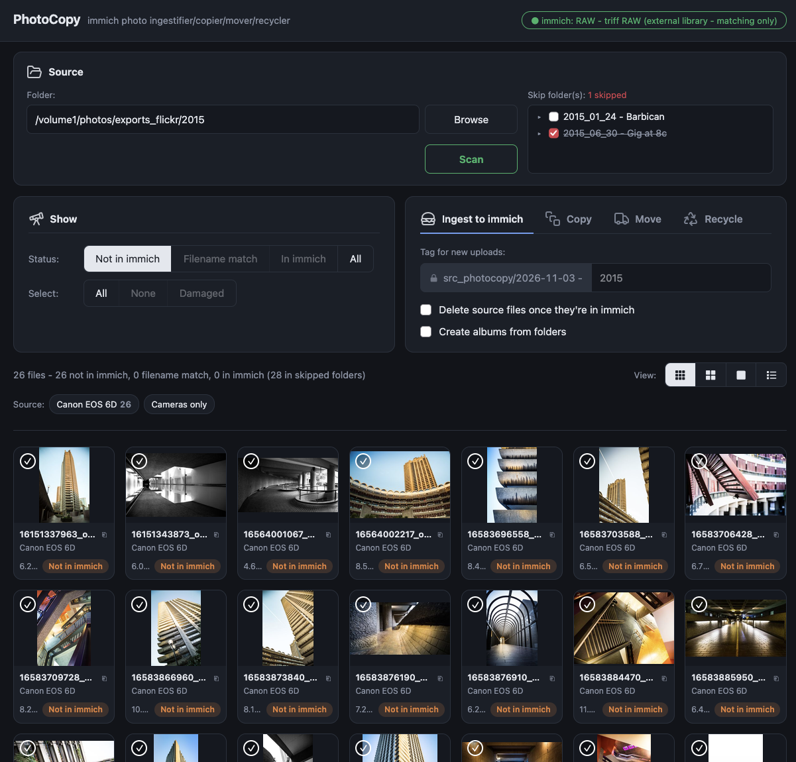

# Immich PhotoCopy

Web app for a NAS running immich. Point it at a folder, see which photos/videos aren't in the chosen immich account then decide what to do with them.

Add missing photos, upgrade filename matches in-place, maintain existing metadata, create albums from folders, copy/move/recycle source files, tag uploads for easy management and flag any damaged files. Works with multiple immich accounts.



- **Matching** - SHA-1 of each file vs the checksums immich stores for that account (read from immich's Postgres)
- **Filename match** - same filename in immich but different bytes - candidates for an in-place upgrade
- **Ingest** - upload to immich, tagged `src_photocopy/<date> - <descriptor>`, optional albums from folders
- **Upgrade** - replaces the immich asset with the new file, keeping albums, tags, favourites and description; old asset goes to immich's trash
- **Copy/Move** - to any folder under the allowed roots, optionally keeping subfolders
- **Recycle/Delete** - source files go to the share's `#recycle`, never deleted outright
- **Damaged files** - JPEGs that don't decode are flagged and never uploaded or used to upgrade
- **Accounts** - compatible with multiple immich API keys, picked from a dropdown in the header

## Safety

- **immich database** - read only (enforced with the read-only role in setup step 3)
- **immich assets** - nothing is deleted, except Upgrade sending the replaced asset to immich's trash (recoverable until the trash empties)
- **Undo** - uploads carry a `src_photocopy/...` tag, upgrades also `src_photocopy/upgraded`, and every upgrade is logged with old and new asset ids in `CACHE_DIR/upgrades.jsonl`
- **Not undone by tags** - albums made by "Create albums from folders"; favourite / stack / shared links moved onto an upgraded asset
- **Local files** - never hard-deleted: Delete, Recycle and "Delete source files" all move to the share's `#recycle`
- **Confirmation** - every action that sends source files to `#recycle` asks first, with a red button; Move asks too (blue)
- **`LIBRARY_PATHS`** - never moved, recycled or deleted from

## Files

| File | |
|---|---|
| `app.py` | server (Python stdlib + Pillow) |
| `index.html` | the page |
| `Dockerfile` | python:3.12-slim + exiftool, psql, ffmpeg, Pillow, pillow-heif |
| `env.example` | settings template |

## Setup

### 1. Code

Put this folder somewhere on the NAS, e.g. `/volume2/scripts/immich/tr-photocopy`.

### 2. immich API keys

One key per immich account you want to match against (immich → Account Settings → API Keys).

Permissions:
- `asset.read`, `asset.upload`, `user.read`
- `tag.create`, `tag.asset`
- `album.create`, `albumAsset.create` (only for "Create albums from folders")

Match-only accounts (external-library accounts) only need `asset.read` and `user.read`.

### 3. Postgres login (read-only)

PhotoCopy only ever reads immich's database. Give it its own read-only role so that's enforced, not just promised.

Open a psql shell in immich's Postgres container (user and database from immich's `.env`: `DB_USERNAME`, `DB_DATABASE_NAME`):

```sh
docker exec -it immich_postgres psql -U <DB_USERNAME> -d <DB_DATABASE_NAME>
```

Then:

```sql
CREATE ROLE photocopy LOGIN PASSWORD '<a new password>';
GRANT CONNECT ON DATABASE <DB_DATABASE_NAME> TO photocopy;
GRANT USAGE ON SCHEMA public TO photocopy;
GRANT SELECT ON asset, asset_exif TO photocopy;
ALTER ROLE photocopy SET default_transaction_read_only = on;
```

`asset` / `asset_exif` are the table names in current immich; older versions used `assets` / `exif`.

| PhotoCopy | value |
|---|---|
| `PGHOST` | the Postgres container name, usually `immich_postgres` |
| `PGUSER` | `photocopy` |
| `PGPASSWORD` | the password above |
| `PGDATABASE` | immich's `DB_DATABASE_NAME` |

Using immich's own `DB_USERNAME` / `DB_PASSWORD` also works, but that login can write.

### 4. Project folder

Create the Docker project folder, e.g. `/volume2/docker/photocopy/`, containing:
- `docker-compose.yaml` (below)
- `.env` - copy of `env.example`, filled in

Also create the thumbnail cache folder, e.g. `/volume2/appdata/photocopy`.

### 5. Compose

```yaml
services:
  photocopy:
    image: tr-photocopy
    build: ${PHOTOCOPY_SRC:-/volume2/scripts/immich/tr-photocopy}
    pull_policy: never
    container_name: photocopy
    restart: unless-stopped
    env_file: .env
    ports:
      - "${BIND_IP:-192.168.0.1}:${PORT:-8791}:${PORT:-8791}"
    volumes:
      - /volume1:/volume1
      - /volume2/appdata/photocopy:/cache
      - ${PHOTOCOPY_SRC:-/volume2/scripts/immich/tr-photocopy}:/app:ro
    networks:
      - immich
    labels:
      - com.centurylinklabs.watchtower.enable=false
networks:
  immich:
    external: true
    name: ${IMMICH_NETWORK:-immich_default}
```

- **Volumes** - mount every root in `ALLOWED_ROOTS` at the same path inside the container
- **Network** - must be immich's network, so `immich_server` and the Postgres container resolve
- **`${…}` values** - read from `.env` next to the compose file; the values after `:-` are fallbacks

### 6. Start

Deploy the project. The log should show one line per key:

```
Immich key Main: OK - <account name>
PhotoCopy on :8791, roots /volume1, active account Main
```

`key rejected` = wrong key or missing permission. A scan stuck at "Reading immich checksums" = wrong Postgres details.

### 7. Reverse proxy (optional)

Proxy a hostname to `BIND_IP:PORT`. No auth built in - keep it LAN / VPN only.

## Updating

- `index.html` changed - reload the page
- `app.py` changed - **Restart** the container (`/app` is mounted, no rebuild)
- `Dockerfile` or compose changed - **Redeploy**

## Settings

All in `.env` - see the comments in `env.example`.

| Setting | |
|---|---|
| `IMMICH_KEY_<NAME>` | one per account; NAME shows in the dropdown as written |
| `IMMICH_DEFAULT` | account on first start; any case; falls back to the first account that can upload |
| `IMMICH_NO_UPLOAD` | accounts that only match |
| `ALLOWED_ROOTS` | where scanning, browsing, copying, moving and deleting are allowed |
| `BLOCKED_DEST` | destinations refused for copy / move / new folder |
| `LIBRARY_PATHS` | never moved, recycled or deleted from |
| `CACHE_DIR` | thumbnails, upgrade log (`upgrades.jsonl`), last-picked account |

## Notes

- **External-library accounts** - uploading to them puts files in immich's upload storage, not their library folders; Copy / Move into the library folder and rescan the library in immich instead
- **Recycle** - files go to `<root>/<share>/#recycle/...`, the UGOS share recycle bin
- **Account switch** - clears the results and rescans the current folder

> [!WARNING]
> Use at your own risk - test on a copy and keep backups. Not affiliated with immich!!

Developed and tested on a UGREEN DXP4800 Plus (UGOS 1.21.0.0190) with immich 3.3.5.
